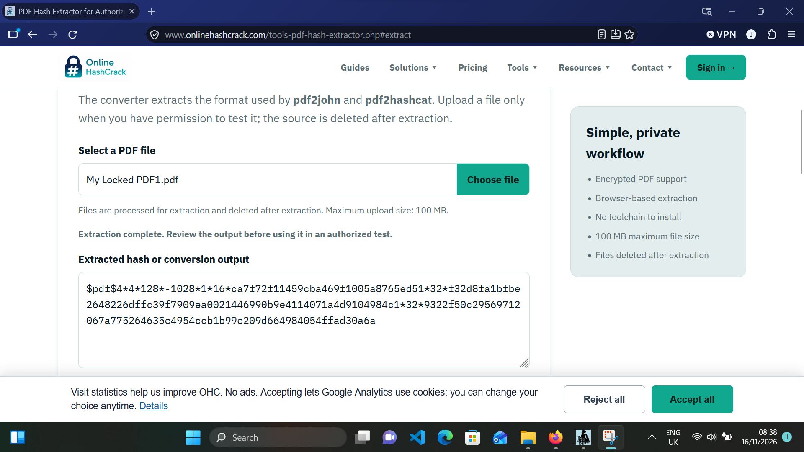
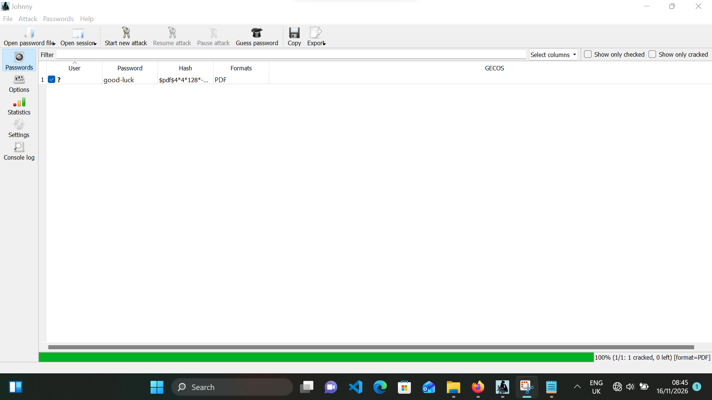
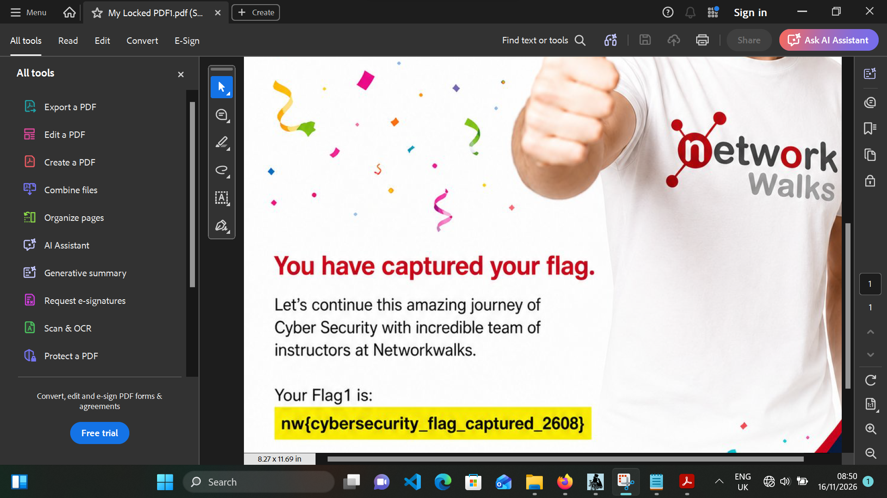
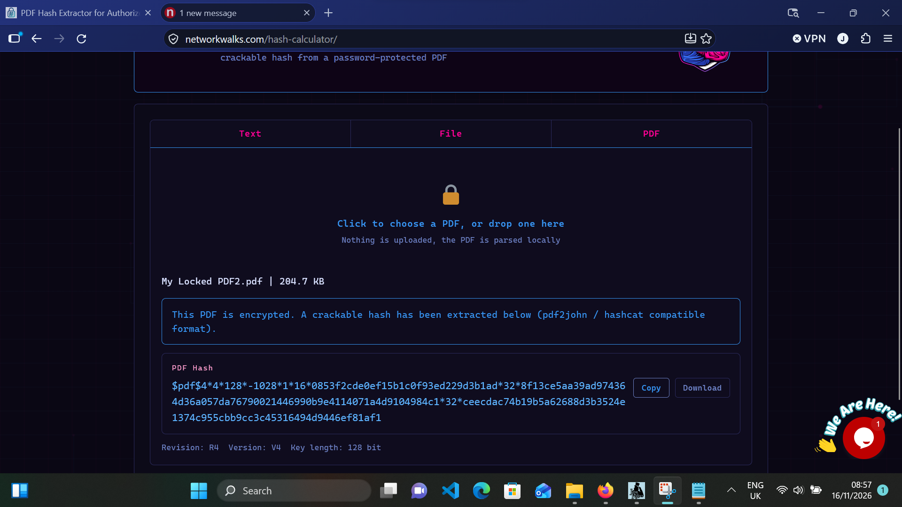
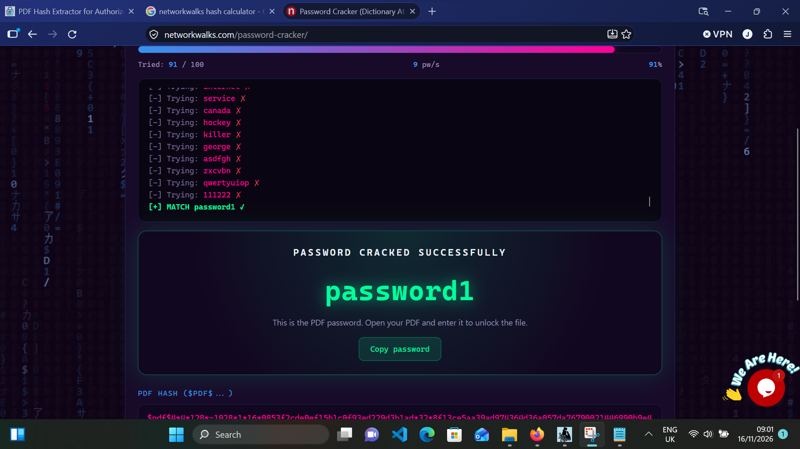

# PDF Password Cracking Lab

A hands-on cybersecurity practical demonstrating PDF hash extraction and password recovery using two different approaches: **John the Ripper (Johnny)** and **NetworkWalks Hash Calculator and Password Cracker**.

## Introduction

As part of my Week 3 Cybersecurity Internship at NetworkWalks, I performed a practical exercise involving two password-protected PDF files.

The exercise focused on extracting PDF password hashes and recovering passwords through dictionary attacks.

This practical was divided into two parts:

1. Part 1 – PDF Password Cracking with Johnny.
2. Part 2 – PDF Password Cracking with NetworkWalks Tools.

## Tools Used

- John the Ripper (Johnny)
- Online PDF Hash Extractor
- NetworkWalks Hash Calculator
- NetworkWalks Password Cracker
- Adobe Acrobat Reader
- Windows

---

# Part 1 – PDF Password Cracking with Johnny

## Overview

In this part, I used an online PDF hash extractor to extract the hash of a password-protected PDF file. I then imported the extracted hash into Johnny and performed a dictionary attack to recover the password.

### Step 1 – Extract PDF Hash

I uploaded the protected PDF file to an online PDF hash extraction tool.

The tool extracted the password hash in a format compatible with John the Ripper.

### Step 2 – Load Hash into Johnny

I opened Johnny and loaded the extracted PDF hash into the application.

Johnny identified the hash format as PDF.

### Step 3 – Perform Dictionary Attack

I initiated the password-cracking process using Johnny.

The tool tested password candidates against the extracted hash until a matching password was found.

### Step 4 – Password Successfully Recovered

The dictionary attack successfully recovered the PDF password.

**Recovered password:** `good-luck`

### Step 5 – Verify the Password

I opened the protected PDF in Adobe Acrobat Reader and entered the recovered password.

The document opened successfully and displayed the captured flag.

**Captured Flag:**

`nw{cybersecurity_flag_captured_2608}`

---

# Part 2 – PDF Password Cracking with NetworkWalks Tools

## Overview

In this part, I used NetworkWalks' online Hash Calculator and Password Cracker to recover the password of a second protected PDF file.

### Step 1 – Open NetworkWalks Hash Calculator

I accessed the NetworkWalks Hash Calculator:

https://networkwalks.com/hash-calculator/

### Step 2 – Upload the Protected PDF

I selected the PDF option and uploaded the second password-protected PDF file.

The tool processed the document and generated its PDF hash.

### Step 3 – Extract and Copy the Hash

After processing, the tool displayed the extracted PDF hash.

I copied the complete hash for the next stage.

### Step 4 – Open NetworkWalks Password Cracker

I accessed the NetworkWalks Password Cracker:

https://networkwalks.com/password-cracker/

### Step 5 – Submit the Extracted Hash

I selected the Text option and pasted the extracted PDF hash into the appropriate field.

### Step 6 – Perform Dictionary Attack

I started the password-cracking process.

The tool tested different password candidates against the supplied hash.

### Step 7 – Password Successfully Recovered

The password cracker identified a matching password.

**Recovered password:** `password1`

### Step 8 – Verify the Password

I entered the recovered password into the second PDF file.

The document opened successfully, confirming that the password was correct.

---

## Key Findings

This practical demonstrated two approaches to PDF password recovery.

- Extracting password hashes from encrypted PDF files.
- Using Johnny as a graphical interface for John the Ripper.
- Performing dictionary attacks against extracted hashes.
- Using NetworkWalks web-based hash extraction and password-cracking tools.
- Recovering weak and commonly used passwords.
- Verifying recovered passwords by opening the protected PDF files.

## What I Learned

Through this practical, I gained hands-on experience in:

- PDF hash extraction.
- Understanding PDF hash formats.
- Using Johnny and John the Ripper.
- Performing dictionary attacks.
- Working with online password-cracking tools.
- Password recovery and verification.
- Documenting cybersecurity practical exercises.

## Conclusion

This Week 3 practical gave me the opportunity to explore PDF password cracking using two different approaches.

Working with Johnny and NetworkWalks tools helped me understand the relationship between hash extraction and dictionary-based password recovery.

It also reinforced the importance of using strong and unique passwords.

## Disclaimer

This exercise was performed as part of a cybersecurity learning programme using authorized lab files.

All password-cracking activities should only be performed on files and systems for which proper authorization has been granted.

## Internship Information

- **Programme:** NetworkWalks Cybersecurity Internship
- **Week:** 03
- **Project:** PDF Password Cracking Lab
- **Focus:** PDF Hash Extraction and Dictionary Attacks